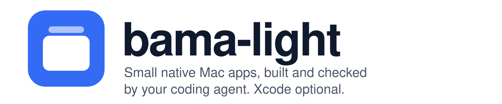

<p align="center">
  <picture>
    <source media="(prefers-color-scheme: dark)" srcset="assets/banner-dark.svg">
    
  </picture>
</p>

<p align="center"><b>Your own native Mac apps, built by your agent and checked before it says done.</b></p>

<p align="center">
  
  
  
  
  
  
</p>

<p align="center">
  <a href="#what-bama-light-does">What it does</a> ·
  <a href="#how-it-compares">How it compares</a> ·
  <a href="#how-it-was-made">How it was made</a> ·
  <a href="#use">Use</a> ·
  <a href="#install">Install</a>
</p>

**bama-light** is a pair of skills that let Claude Code or Codex build small native Mac apps in SwiftUI:
your own tools, local data, no server. The agent builds the app, runs it, and looks at every screen before it
tells you it's done. The template and its whole build-and-check workflow work with only Apple's Command Line Tools; widgets, extensions and App Intents need Xcode.

https://github.com/user-attachments/assets/f9a79321-5524-44d6-8e86-676201a61e3e

## Sound familiar?

Ask a coding agent for a Mac app and you tend to get:

- an iPhone layout in a Mac window: a bottom bar, large titles, touch-sized buttons;
- "install Xcode first", or an `.xcodeproj` the agent can't safely edit;
- Swift 6 concurrency errors silenced with `@unchecked Sendable` until the app crashes;
- a screen the agent never looked at, so a clipped label or an empty pane ships;
- an Accessibility or Screen Recording grant that has to be given again after every build;
- planning documents and backlog files wrapped around what should be a small tool.

## Why it matters to your agent

The agent already knows Swift and SwiftUI. What it lacks is a way to see the window, a project it can build
from the command line, and the Mac-specific rules that are easy to get wrong: where toolbar items go, how
Settings and menus behave, which permissions survive a rebuild. Without those it guesses, and each guess costs
you a round of "that's not how a Mac app looks".

## What bama-light does

- **A working template.** A Swift package with no Xcode project that builds, signs and installs a real `.app`,
  with a local Core Data store, Settings, menus, undo and an app icon.
- **Checks the agent can see.** A snapshot mode saves every page and Settings tab as a PNG in light and dark
  mode with sample data; a self-test runs the app's real functions; starter unit tests for the app's logic. They run behind
  your windows without taking the keyboard, and they refuse to touch your real data.
- **The Mac-specific traps.** Toolbar and menu rules, windows that open calm, Swift 6 concurrency pitfalls,
  menu bar apps and panels, permissions and signing for system integrations, and profiling without Instruments.
- **A design step.** Look at real Mac apps, borrow mood from design galleries, mock up two or three layouts,
  then check the chosen one in real SwiftUI.
- **Optional agent access.** The `agent-cli` skill turns the app's binary into a CLI and an MCP server, so
  Claude, Codex or scripts can drive the running app.

The plan lives in the conversation; the code and the checks live in the repository. No brief, backlog or
review files.

## How it compares

| | Needs Xcode | Agent checks the UI | Files beside the code |
|---|---|---|---|
| Xcode's app template | yes | no | none |
| [BAMA](https://github.com/daveebbelaar/bama) | yes | yes: snapshots, layout lint | brief, research, stories |
| **bama-light** | no (optional) | yes: snapshots, self-test, unit tests | none |

## How it was made

bama-light is built on [BAMA (Build Any Mac App)](https://github.com/daveebbelaar/bama) by
[Dave Ebbelaar](https://github.com/daveebbelaar), MIT-licensed agent skills to research, clone, design, build,
optimize and test native Mac apps. BAMA showed that an agent can build a real Mac app when it has a working
template, snapshots it can look at, and the Mac know-how written down. bama-light keeps those ideas and trims
the rest for personal apps:

1. **Without Xcode.** BAMA's template moved from SwiftData to Core Data with the model in code, so it builds,
   tests and makes its icon with only the Command Line Tools.
2. **Unbloated.** Claude and Codex each reviewed BAMA separately for what is core and what is ritual, then
   [unbloat](https://github.com/workflowsdiy/unbloat) did the deep clean: process skills (research, brief,
   stories, improve loops) went, repeated and generic guidance went, and every remaining rule had to change an
   outcome. unbloat's gate runs on every commit here, so the docs stay within a line budget.
3. **Checked by two models.** Codex and separate Claude agents each read the skills, the template and the
   scripts; every finding was confirmed against the code before it was fixed.
4. **A/B tested.** The same 11-story clipboard-history app was built from one spec with each skill set, by the
   same model: once with only bama-light and once with only BAMA. Codex compared the two story by story. The
   bama-light build came out narrowly ahead on tests, image handling and looks; BAMA's had a few better UI
   details. What both builds got wrong was folded into the guidance.

## Use

Ask in plain words: "build me a menu bar app that ...", "add a Settings tab for ...", "let Claude use my app
from the command line". The agent picks up `mac-app` (or `agent-cli`) on its own.

## Install

Claude Code:

```text
/plugin marketplace add workflowsdiy/bama-light
/plugin install bama-light@bama-light
```

Or from a shell: `claude plugin marketplace add workflowsdiy/bama-light`, then
`claude plugin install bama-light@bama-light`.

Codex:

```bash
codex plugin marketplace add workflowsdiy/bama-light
codex plugin add bama-light@bama-light
```

By hand, for any agent that reads skill folders:

```bash
git clone https://github.com/workflowsdiy/bama-light.git
mkdir -p ~/.claude/skills && ln -s "$PWD/bama-light/skills"/* ~/.claude/skills/
```

For Codex by hand, link the same folders into `~/.agents/skills/`.

## Requirements

- macOS 26 or later.
- The Command Line Tools (`xcode-select --install`) or Xcode. With Xcode you
  also get Liquid Glass app icons, Instruments, and SwiftData.
- For the most useful snapshots, Screen Recording permission for the
  terminal or app that runs the agent. Without it, snapshots fall back to a
  drawing that leaves sidebars and glass blank.

## Development

Check a change to the skills by making an app from the template and running
its checks, once with Xcode and once with only the Command Line Tools:

```bash
zsh skills/mac-app/scripts/new-app.sh Probe com.example.probe /tmp
cd /tmp/Probe && ./build.sh && tools/selftest.sh && tools/test.sh && tools/snap.sh
DEVELOPER_DIR=/Library/Developer/CommandLineTools ./build.sh
```

For `agent-cli`, add it to that app with `skills/agent-cli/scripts/add-agent-cli.sh`,
build, and run `skills/agent-cli/scripts/check-agent-cli.sh <cli-name>`.
Commits pass `unbloat-check` ([unbloat](https://github.com/workflowsdiy/unbloat)),
configured in `.unbloat.json`.

## Credits

Built on [BAMA](https://github.com/daveebbelaar/bama) by [Dave Ebbelaar](https://github.com/daveebbelaar) (MIT);
his copyright notice is kept in [LICENSE](LICENSE). Slimmed and kept lean with
[unbloat](https://github.com/workflowsdiy/unbloat).
